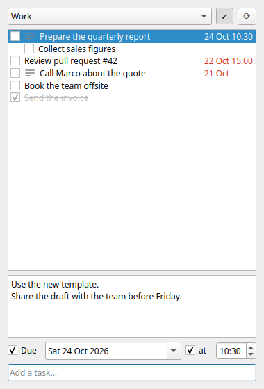

# Taskling

**Your Google Tasks, one click away in the Linux system tray.**

[](LICENSE)


Taskling is a small, open source Google Tasks client for the Linux desktop. Click its tray icon and a
checklist pops up: tick tasks off, add new ones, write details, set due dates and reminders. Everything
syncs with the official Google Tasks app on your phone. A command line interface does the same from the
terminal, and its JSON output makes your to-do list easy to manage from scripts and AI assistants.

<p align="center">
  
</p>

## Why

Google Tasks has an app for phones and a side panel in Gmail and Calendar, but no desktop client. Full
project management tools are overkill for a simple to-do list. Taskling sits in the system tray next to
your other applets, opens instantly and stays out of the way.

## Features

- **Checklist in the tray**: tick a task to complete it, untick it to reopen it
- **Quick capture**: type a task and press Enter
- **Details**: read and edit the notes of a task; tasks with details are marked with ≡
- **Due dates**, synced with Google Tasks, shown in red when overdue and in blue when due today
- **Reminders**: a desktop notification on the due date at the time you choose
- **Drag and drop** to reorder tasks, synced with Google Tasks
- **Subtasks** shown under their parent, **multiple lists**, optional view of **completed tasks**
- **Command line** for every operation, with `--json` output for scripts
- **Private by design**: it talks directly to Google with your own OAuth client, no servers in between
- **Lightweight**: pure Python and PyQt6, no other dependencies

## Requirements

- Linux with a system tray (LXQt, KDE Plasma, Xfce, MATE, Cinnamon, …; GNOME needs the
  *AppIndicator* extension)
- Python 3.10 or newer
- PyQt6
- A Google account

Taskling is developed and tested on Lubuntu 24.04 (LXQt, X11).

## Installation

On Ubuntu and its flavours:

```bash
sudo apt install python3-pyqt6 python3-venv git
git clone https://github.com/miacono/taskling.git
cd taskling
./install.sh --autostart    # leave out --autostart if you don't want Taskling to start at login
```

The script installs Taskling for the current user only, without root:

- a virtual environment in `~/.local/share/taskling/venv`, which reuses the system PyQt6
- the `taskling` command in `~/.local/bin`
- a *Taskling* entry in the applications menu
- with `--autostart`, an entry in `~/.config/autostart`

The installation is editable: after a `git pull` the new code is used at the next start, without
reinstalling.

## Connecting to Google

Taskling uses an OAuth client that you create in your own Google Cloud project, so your tasks never go
through anyone else's application. It is free and only needs to be done once.

1. Open the [Google Cloud console](https://console.cloud.google.com/) and create a project, for example
   `taskling`.
2. Go to **APIs & Services → Library**, search for **Google Tasks API** and enable it.
3. Go to **Google Auth Platform** (the OAuth consent screen) and click **Get started**: enter an app name
   and your email address. As the audience choose **External**, or **Internal** if your account belongs
   to a Google Workspace organization.
4. With an **External** audience, open **Audience**, add your address as a test user and click
   **Publish app** (see the note below).
5. Go to **Clients → Create client**, choose the application type **Desktop app** and create it. Download
   the JSON file and save it as `~/.config/taskling/client_secret.json`:

   ```bash
   mkdir -p ~/.config/taskling
   mv ~/Downloads/client_secret_*.json ~/.config/taskling/client_secret.json
   ```

6. Sign in:

   ```bash
   taskling auth
   ```

   The browser opens: choose your account and allow access to Google Tasks.

> [!NOTE]
> While an External app is in *Testing* status, Google makes its sign-ins expire after 7 days. Publishing
> the app avoids signing in every week. Since the app is not verified by Google, the sign-in page shows a
> warning: this is expected for a personal client, choose **Advanced → Go to taskling**.
> Internal (Workspace) apps don't have this limit.

You can also sign in from the tray icon menu (**Sign in to Google…**).

## Usage

### Tray app

Start Taskling from the applications menu, or run `taskling`. Then click the tray icon:

| To | Do |
|---|---|
| complete or reopen a task | tick or untick its box |
| add a task | type in *Add a task…* and press Enter |
| rename a task | double-click it, or select it and press F2 |
| delete a task | select it and press Delete, or right-click it |
| reorder tasks | drag a task up or down; a line shows where it will land |
| make a task a subtask | drag it right below a task that already has subtasks |
| edit the details | select the task and write in the box below the list |
| set a due date | tick **Due** and pick the date |
| set a reminder | tick **at** and set the time |
| switch list | use the drop-down at the top |
| show completed tasks | toggle the ✓ button |

Changes are saved as you make them. The list refreshes every five minutes and every time you open it.
Right-click the tray icon for **Refresh**, **Sign in to Google…** and **Quit**.

### Command line

```text
taskling                        start the tray app (same as 'taskling tray')
taskling auth                   sign in to Google
taskling lists                  show the task lists; * marks the current one
taskling use Work               choose the current list (by title, number or id)
taskling ls [-a] [-d] [--json]  show the open tasks, numbered
                                  -a: include completed tasks, -d: show details
taskling add TITLE [-n DETAILS] [--due DATE] [--at HH:MM]
taskling done 1 3               complete tasks, by the numbers shown by 'ls'
taskling undo 5                 reopen a completed task (numbers from 'ls -a')
taskling edit 2 [TITLE] [-n DETAILS] [--due DATE] [--at HH:MM]
taskling mv 3 --top             move a task to the top of the list
taskling mv 3 --after 5         move a task right after another one, at the same level
taskling mv 3 --under 1         make a task the first subtask of another one
taskling rm 4                   delete a task
```

Every task command accepts `-l LIST` to work on a list other than the current one. Dates can be written
as `YYYY-MM-DD`, `DD/MM`, `DD/MM/YYYY`, `today` or `tomorrow`. `--at` without a due date sets the due
date to today. In `edit`, an empty value (`-n ""`, `--due ""`, `--at ""`) clears the field.

Examples:

```bash
taskling add "Call Marco about the quote" --due tomorrow --at 9:30
taskling edit 3 -n "Ask for the updated price list"
taskling ls -d
taskling ls --json | jq '.tasks[] | select(.due != null) | .title'
```

## Reminders and API limits

The [Google Tasks API](https://developers.google.com/workspace/tasks) has two limits that shape how
Taskling works:

- **Due times are not available.** The API stores only the *date* of a due date: it discards the time,
  and the time set in the Google Tasks app cannot be read. Taskling therefore syncs the due date with
  Google, and keeps the reminder time on your computer, in `~/.config/taskling/reminders.json`. The tray
  app shows the notifications, including those for lists that are not on screen and those missed while
  the computer was off. On your phone you see the due date without the time.
- **Starred tasks are not available.** The API does not expose the star, so Taskling can neither show nor
  set it.

## Files

| Path | Content |
|---|---|
| `~/.config/taskling/client_secret.json` | your OAuth client |
| `~/.config/taskling/token.json` | sign-in tokens |
| `~/.config/taskling/settings.json` | the current list |
| `~/.config/taskling/reminders.json` | reminder times |
| `~/.cache/taskling/taskling.log` | log of the changes sent to Google and of errors |

For a detailed log of what the tray app does, start it with `TASKLING_DEBUG=1 taskling`.

## Privacy and security

- Taskling talks only to Google, using your own OAuth client. There is no Taskling server and no
  telemetry.
- It asks for a single permission: access to Google Tasks (`https://www.googleapis.com/auth/tasks`).
- Sign-in follows the OAuth flow for installed apps, with PKCE and a redirect to `127.0.0.1`.
- The configuration files are readable only by your user.

To sign out, delete `~/.config/taskling/token.json` and remove Taskling's access from your
[Google Account permissions](https://myaccount.google.com/permissions).

## Uninstalling

```bash
rm -rf ~/.local/share/taskling ~/.local/bin/taskling \
       ~/.local/share/applications/taskling.desktop ~/.config/autostart/taskling.desktop \
       ~/.local/share/icons/hicolor/scalable/apps/taskling.svg
rm -rf ~/.config/taskling ~/.cache/taskling    # also removes your sign-in, settings and reminders
```

## Development

Run Taskling from the source tree, without installing it:

```bash
PYTHONPATH=src python3 -m taskling ls
PYTHONPATH=src python3 -m taskling tray
```

The code lives in `src/taskling/`:

| Module | Role |
|---|---|
| `api.py` | Google Tasks REST API client |
| `auth.py` | OAuth sign-in and token refresh |
| `cli.py` | command line interface |
| `tray.py` | tray icon, popup and reminder notifications |
| `reminders.py` | locally stored reminder times |
| `config.py` | file locations and settings |

Issues and pull requests are welcome.

## License

Taskling is free software, released under the [GNU Affero General Public License v3.0](LICENSE) or later.

Google Tasks is a trademark of Google LLC. Taskling is an independent project, not affiliated with or
endorsed by Google.
